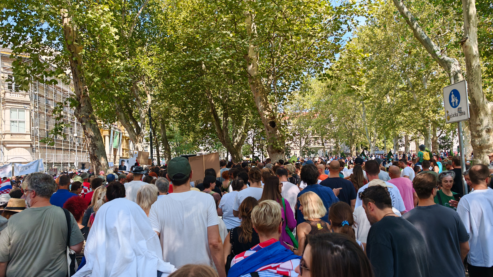

# Baby OSINT

| Поле | Значение |
|---|---|
| Платформа | FortID CTF |
| Категория | OSINT |
| Файл задания | [`handout.jpeg`](handout.jpeg) |
| Статус | Решено |
| Флаг | `FortID{ho...tsku:ze...ge:we...day:9...9}` (masked) |

## Условие

На фотографии показана большая акция в центре Загреба. Нужно было ответить на четыре вопроса:

1. Как называлось мероприятие на фотографии?
2. Какой гастрономический фестиваль проходил в Загребе в тот же день и получил публичную поддержку организаторов акции?
3. В какой день недели было больше всего поездок на новых городских велосипедах?
4. Какое максимальное число этих велосипедов одновременно зафиксировали в одном месте?

Ответы нужно было привести к нижнему регистру, заменить пробелы на подчёркивания и убрать пунктуацию.

## 1. Что можно понять по самой фотографии

На правой стороне кадра видна табличка `Pješačka zona`, то есть «пешеходная зона». Архитектура и язык указывают на Хорватию, а по городскому окружению это Загреб.

На плакатах в толпе читается слово `LIKA`. Это полезная зацепка: Lika - исторический регион Хорватии, а не название случайного концерта или политической партии. Поэтому я искал загребскую акцию с названием, связанным с Ликой.

## 2. Название акции

Поиск по сочетаниям `Lika`, `Zagreb`, `hodaj` и фотографии вывел на акцию **Hodaj za Liku, hodaj za Hrvatsku** - «Шагай за Лику, шагай за Хорватию».

Это и есть первый ответ. Для формата флага:

Найденное значение: `ho...tsku` (masked).

Важно сохранить хорватское написание `Hrvatsku`, а при нормализации использовать только английские латинские буквы и нижний регистр.

## 3. Фестиваль в тот же день

Дальше я проверил новости и страницы организаций, которые участвовали в акции. В публикациях о мероприятии рядом с датой акции упоминался связанный гастрономический фестиваль.

Организаторы фестиваля публично поддержали акцию. Это связывает его с условием задачи лучше, чем просто совпадение по месту: нужен был именно фестиваль, проходивший в Загребе в тот же день и поддержавший мероприятие.

Найденное значение: `ze...ge` (masked).

## 4. День с наибольшим числом поездок

Третья часть относится к новым загребским городским велосипедам. В условии дана ссылка на видео, где мэр пытается проехать на таком велосипеде. По публикациям оператора системы и связанным статистическим материалам я сравнил среднее число поездок по дням недели.

Наибольшее среднее значение приходится на один конкретный день недели. Найденное значение: `we...day` (masked).

## 5. Максимальное число велосипедов в одной точке

Здесь легко перепутать два близких числа из разных временных выборок. Для задания нужно значение из публикации, описывающей нужное событие. Найденное значение: `9...9` (masked).

## Итог

Все четыре значения подтверждены по открытым источникам. Сам ответ намеренно не публикуется, чтобы writeup не раскрывал решение целиком.

## Источники

- [Prijatelji životinja - материал об акции и поддержке фестиваля](https://www.prijatelji-zivotinja.hr/index.hr.php?id=5285)
- [Index.hr - данные о велосипедах и числе участников/велосипедов](https://www.index.hr/fit/clanak/vise-od-900-ljudi-na-inmusic-doslo-bajsom/2805907.aspx)
- [Bajs - статистика событий](https://bajs.informacija.hr/events)

## Короткий вывод

Фотография дала место и ключевое слово `LIKA`. Через поиск по хорватским названиям нашлось мероприятие, затем по публикациям организаторов - связанный гастрономический фестиваль. Последние два поля потребовали сверить статистику городской велосистемы и не подменить значение из нужной выборки похожим пиковым значением из другой.
